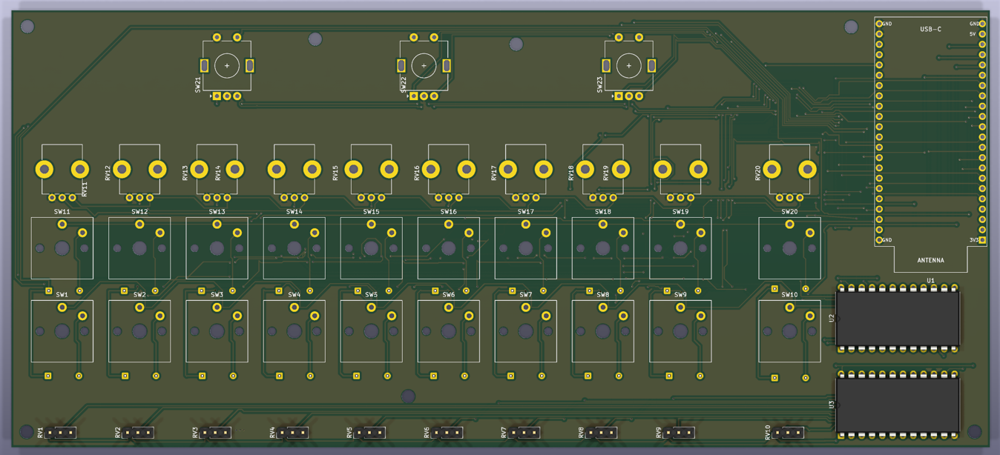
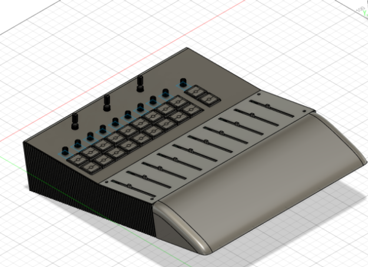
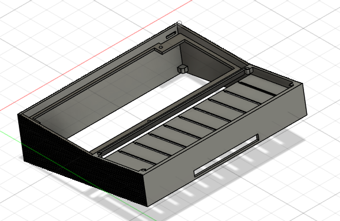
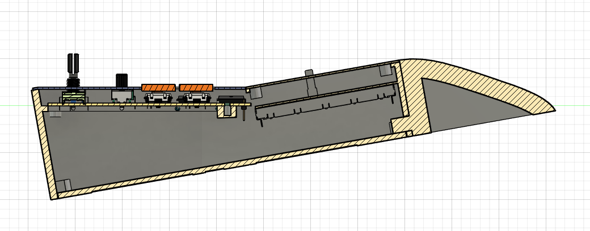

# MIDI-controller-DIY

A DIY project for a MIDI controller designed to control lights, featuring knobs, faders, and buttons.

The project is designed to manage stage lighting systems with up to 10 faders, including a master one, 20 keyboard keys, 10 potards, and 3 rotary encoders.

The goal is to not pay hundreds of dollars for an already existing product, and learn! MIDI controller DIY is also intended to be a hardware platform for a future open-source lighting-control system.

---

## Features

* 20 usable keyboard keys
* 10 faders
* 10 potards
* 3 rotary encoders
* USB-C Output
* Compatibility with all lighting control systems via MIDI
* You can also use it as an instrument or anything else
* Compact and portable design
* Designed for DIY assembly and reproduction
* Low-cost hardware

And the design is made to be upgradable/updatable easily if necessary, so it will be able to last over time.

---

## Architecture

The ESP32-S3 is the central processor of the system. It handles USB-C communication and MIDI processing. To connect the ESP32 with all of the 43 components, there are 2 MUX units at the right of the box. 43 buttons, faders, etc., are fully customizable and you can use them as you want.

---

## Hardware and BOM

The current design uses the following main components:

| Component | Price |
| --- | --- |
| [Kailh Choc V1 1350](https://fr.aliexpress.com/item/1005012826040037.html) | 9.86$ |
| [RV09 B10K 9 mm vertical](https://fr.aliexpress.com/item/1005005951601744.html) | 7.83$ |
| [EC11 through-hole with push-button, 20 mm shaft](https://fr.aliexpress.com/item/1005009889978797.html) | 5.36$ |
| [CD4067BE in DIP-24](https://fr.aliexpress.com/item/1005011580802574.html) | 6.69$ |
| [1N4148 diodes](https://fr.aliexpress.com/item/4000142272546.html) | 1.64$ |
| [faders SC1009G B10K](https://fr.aliexpress.com/item/1005007799302164.html) | 9.23$ |
| [ESP32-S3 N16R8](https://fr.aliexpress.com/item/1005008809316571.html) | 8.02$ |
| [PCB](https://jlcpcb.com/) | 16.60$ |
| **Total** | **65.23$** |

The complete component list is available in [BOM.csv](BOM.csv).

---

## Processing and memory

I selected the ESP32-S3 because the project requires a bit of processing power for MIDI handling, though not a huge amount. That’s why it’s better suited for the task than a Raspberry Pi.

It is responsible for:

* MIDI processing
* USB-C Output
* 42 component inputs

All the data, saves, and other settings are stored in the internal storage system of the ESP32.

---

## MIDI

The MIDI controller is designed to support lighting control software like grandMA onPC, QLC+, or others via standard MIDI remote commands.

Each hardware input reads multiple analog faders, push buttons, and encoders through multiplexers or direct GPIO pins on the ESP32.

Standard USB-MIDI and serial communication protocols are used, handled by the hardware USB/UART interfaces on the microcontroller.

The MIDI data rate operates at standard MIDI baud rates or high-speed USB-MIDI.

For example, moving a physical fader transmits a Control Change (CC) message to precisely control lighting playback levels in software.

---

## Components and enclosure

There is a PCB in this project because it's required. Here are all the components included:

* ESP32-S3 x1
* MUX CD4067BE in DIP-24 x2
* Kailh Choc V1 1350 x20
* RV09 B10K 9 mm vertical x10
* EC11 through-hole with push-button x3
* faders SC1009G B10K x10

Here's a screenshot of the PCB with some of the components:

The PCB file is [here](3D-files/PCB.step).
And you can modify it using KiCad with [this](KiCad%20-%20MIDI-controller) folder.

The case is 273mm x 250mm x 60mm, and is designed to perfectly house all components, be easy to install, not take up much space, and be durable.

Here's a look at it:

Assembly file: [assembly-Midi-controller-DIY.step](3D-files/assembly/assembly-Midi-controller-DIY.step)  
Print file: [to print](to%20print)

---

## Estimated cost

The current estimate is $65.23 of components.
This does not include assembly, enclosure parts, future design changes, or the print filament that I already have.

---

## Project journal

The development process is documented in [JOURNAL.md](JOURNAL.md).

It includes in-depth design, configuration, part of the code, enclosure design, BOM creation, and the problems encountered during development.

---

## Inspiration and credits

The DMX Unit DIY project was inspired by the GrandMa Wing.

The DMX Unit DIY is an independent design developed from this inspiration.

Credits:
* GrandMa Wing — inspiration for the project concept and overall goal of creating an affordable DMX interface.
* GrabCAD community — some 3D component models were used as reference geometry for the CAD assembly. The original authors retain ownership of their respective models:
  * ESP32-S3
  * MUX CD4067BE in DIP-24
  * Kailh Choc V1 1350
  * RV09 B10K 9 mm vertical
  * EC11 through-hole with push-button
  * faders SC1009G B10K
