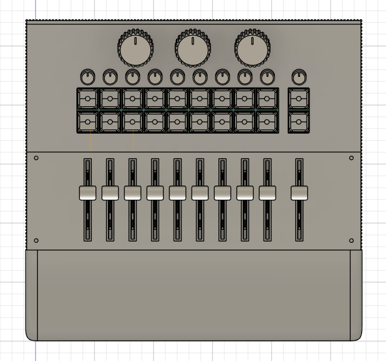
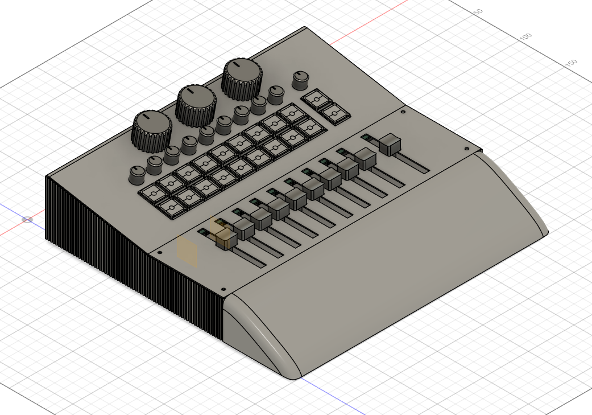
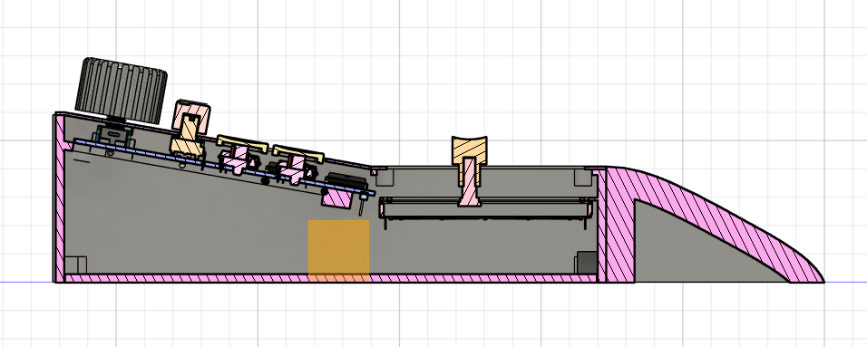

# MIDI-controller-DIY

A DIY project for a MIDI controller designed to control lights, featuring knobs, faders, and buttons.

The project is designed to manage stage lighting systems with up to 10 faders, including a master one, 20 keyboard keys, 10 potards, and 3 rotary encoders.

The goal is to not pay hundreds of dollars for an already existing product, and learn! MIDI controller DIY is also intended to be a hardware platform for a future open-source lighting-control system.

---

## Features

* 20 usable keyboard keys
* 10 faders
* 10 potards
* 3 rotary encoders
* USB-C Output
* Compatibility with all lighting control systems via MIDI
* You can also use it as an instrument or anything else
* Compact and portable design
* Designed for DIY assembly and reproduction
* Low-cost hardware

And the design is made to be upgradable/updatable easily if necessary, so it will be able to last over time.

---

## Architecture

The ESP32-S3 is the central processor of the system. It handles USB-C communication and MIDI processing. To connect the ESP32 with all of the 43 components, there are 2 MUX units at the right of the box. 43 buttons, faders, etc., are fully customizable and you can use them as you want.

---

## Hardware and BOM

The current design uses the following main components:

| Component | Quantity | Price |
| --- | --- | --- |
| [Kailh Choc V1 1350](https://fr.aliexpress.com/item/1005012826040037.html?spm=a2g0o.cart.0.0.478d378dYODNq0&mp=1&pdp_npi=6%40dis%21USD%21USD%205.36%21USD%204.93%21%21USD%204.93%21%21%21%40210384a717913205885618903e10fc%2112000059425505100%21ct%21FR%218054027548%21%212%210%21&gatewayAdapt=glo2fra) | 20 | 9.86$ |
| [RV09 B10K 9 mm vertical](https://fr.aliexpress.com/item/1005005951601744.html?spm=a2g0o.productlist.main.2.6a013a5dBfqj0c&algo_pvid=9dd7ff78-7cef-4815-a249-9f4bb1d433f4&algo_exp_id=9dd7ff78-7cef-4815-a249-9f4bb1d433f4-1&pdp_ext_f=%7B%22order%22%3A%22197%22%2C%22eval%22%3A%221%22%2C%22fromPage%22%3A%22search%22%7D&pdp_npi=6%40dis%21USD%217.66%217.66%21%21%2151.02%2151.02%21%4021613be817921531317277993e10c3%2112000034999053530%21sea%21FR%218054027548%21X%211%210%21n_tag%3A-29911%3Bd%3A8484f755%3Bm03_new_user%3A-29895&curPageLogUid=b76fqSVCkx9n&utparam-url=scene%3Asearch%7Cquery_from%3A%7Cx_object_id%3A1005005951601744%7C_p_origin_prod%3A) | 10 | 7.90$ |
| [EC11 through-hole with push-button, 20 mm shaft](https://fr.aliexpress.com/item/1005009889978797.html?spm=a2g0o.cart.0.0.478d378dYODNq0&mp=1&pdp_npi=6%40dis%21USD%21USD%205.88%21USD%202.68%21%21USD%202.68%21%21%21%40210384a717913207470334482e10fc%2112000050490958429%21ct%21FR%218054027548%21%212%210%21&gatewayAdapt=glo2fra) | 3 | 5.36$ |
| [CD4067BE in DIP-24](https://fr.aliexpress.com/item/1005011580802574.html?spm=a2g0o.cart.0.0.478d378dYODNq0&mp=1&pdp_npi=6%40dis%21USD%21USD%206.69%21USD%206.69%21%21USD%206.69%21%21%21%40210384a717913207470334482e10fc%2112000055976316177%21ct%21FR%218054027548%21%211%210%21&gatewayAdapt=glo2fra) | 2 | 6.69$ |
| [1N4148 diodes](https://fr.aliexpress.com/item/4000142272546.html?spm=a2g0o.cart.0.0.478d378dYODNq0&mp=1&pdp_npi=6%40dis%21USD%21USD+1.64%21USD+1.64%21%21USD+1.64%21%21%21%40210384a717913207470334482e10fc%2110000000428321629%21ct%21FR%218054027548%21%211%210%21&pdp_ext_f=%7B%22cart2PdpParams%22%3A%7B%22pdpBusinessMode%22%3A%22retail%22%7D%7D&gatewayAdapt=glo2fra) | 20 | 1.64$ |
| [faders SC6021N 10k](https://fr.aliexpress.com/item/1005007799302164.html?spm=a2g0o.productlist.main.1.25616b84d4WSxL&algo_pvid=9953769d-b040-40bf-b6fd-b3c135a11ea9&algo_exp_id=9953769d-b040-40bf-b6fd-b3c135a11ea9-0&pdp_ext_f=%7B%22order%22%3A%22247%22%2C%22spu_best_type%22%3A%22price%22%2C%22eval%22%3A%221%22%2C%22fromPage%22%3A%22search%22%7D&pdp_npi=6%40dis%21USD%212.25%212.25%21%21%2115.00%2115.00%21%400b88486a17915615343565643e0f22%2112000042240271501%21sea%21FR%218054027548%21X%211%210%21n_tag%3A-29911%3Bd%3A8484f755%3Bm03_new_user%3A-29895&curPageLogUid=HQigGaQEblGd&utparam-url=scene%3Asearch%7Cquery_from%3A%7Cx_object_id%3A1005007799302164%7C_p_origin_prod%3A) | 10 | 9$ |
| [ESP32-S3 N16R8](https://fr.aliexpress.com/item/1005008809316571.html?spm=a2g0o.cart.0.0.478d378dYODNq0&mp=1&pdp_npi=6%40dis%21USD%21USD+8.02%21USD+8.02%21%21USD+8.02%21%21%21%40210384a717913207470334482e10fc%2112000046760012013%21ct%21FR%218054027548%21%211%210%21&pdp_ext_f=%7B%22cart2PdpParams%22%3A%7B%22pdpBusinessMode%22%3A%22retail%22%7D%7D&gatewayAdapt=glo2fra) | 1 | 8.02$ |
| [Knobs cap](https://fr.aliexpress.com/item/1005012925297636.html?spm=a2g0o.productlist.main.3.703f7c3epPU0Mz&algo_pvid=4c36b13e-f743-447c-8d31-d169bc98973d&algo_exp_id=4c36b13e-f743-447c-8d31-d169bc98973d-2&pdp_ext_f=%7B%22order%22%3A%2243%22%2C%22spu_best_type%22%3A%22price%22%2C%22eval%22%3A%221%22%2C%22fromPage%22%3A%22search%22%7D&pdp_npi=6%40dis%21USD%211.88%212.68%21%21%2112.52%2117.86%21%40210384a717915626045184749e0d20%2112000059797212246%21sea%21FR%218054027548%21X%211%210%21n_tag%3A-29911%3Bd%3A8484f755%3Bm03_new_user%3A-29895&curPageLogUid=mtFiF5q8pKs0&utparam-url=scene%3Asearch%7Cquery_from%3A%7Cx_object_id%3A1005012925297636%7C_p_origin_prod%3A) | 10 | 2.68$ |
| [PCB](https://jlcpcb.com/) | 1 | 16,60$ |
| [Lowprofile keycaps](https://fr.aliexpress.com/item/1005006624568390.html?spm=a2g0o.productlist.main.39.7ada7cc1xmwatk&algo_pvid=869ea550-58a6-4ce8-a4f5-cac4802f06d0&algo_exp_id=869ea550-58a6-4ce8-a4f5-cac4802f06d0-36&pdp_ext_f=%7B%22order%22%3A%2288%22%2C%22eval%22%3A%221%22%2C%22fromPage%22%3A%22search%22%7D&pdp_npi=6%40dis%21USD%218.67%218.67%21%21%2157.76%2157.76%21%402103849717915626622064135e13a7%2112000037855001108%21sea%21FR%218054027548%21X%211%210%21n_tag%3A-29911%3Bd%3A8484f755%3Bm03_new_user%3A-29895&curPageLogUid=p3pCjUj8SJOC&utparam-url=scene%3Asearch%7Cquery_from%3A%7Cx_object_id%3A1005006624568390%7C_p_origin_prod%3A) | 20 | 17.34$ |
| Total | --- | 85.09$ |

The complete component list is available in [BOM.csv](BOM.csv).

---

## Processing and memory

I selected the ESP32-S3 because the project requires a bit of processing power for MIDI handling, though not a huge amount. That’s why it’s better suited for the task than a Raspberry Pi.

It is responsible for:

* MIDI processing
* USB-C Output
* 43 component inputs

All the data, saves, and other settings are stored in the internal storage system of the ESP32.

---

## MIDI

The MIDI controller is designed to support lighting control software like grandMA onPC, QLC+, or others via standard MIDI remote commands.

Each hardware input reads multiple analog faders, push buttons, and encoders through multiplexers or direct GPIO pins on the ESP32.

Standard USB-MIDI and serial communication protocols are used, handled by the hardware USB/UART interfaces on the microcontroller.

The MIDI data rate operates at standard MIDI baud rates or high-speed USB-MIDI.

For example, moving a physical fader transmits a Control Change (CC) message to precisely control lighting playback levels in software.

---

## Components and enclosure

There is a PCB in this project because it's required. Here are all the components included:

* ESP32-S3 x1
* MUX CD4067BE in DIP-24 x2
* Kailh Choc V1 1350 x20
* RV09 B10K 9 mm vertical x10
* EC11 through-hole with push-button x3
* faders SC6021N B10K x10

Here's a screenshot of the PCB with some of the components:

The PCB file is [here](3D-files/PCB.step).
And you can modify it using KiCad with [this](KiCad%20-%20MIDI-controller) folder.

The case is 283mm x 250mm x 60mm, and is designed to perfectly house all components, be easy to install, not take up much space, and be durable.

Here's a look at it:

Assembly file: [assembly-Midi-controller-DIY.step](3D-files/assembly-Midi-controller-DIY.step)  
Print file: [to print](3D-files/to%20print/)

---

## Estimated cost

The current estimate is $85.09 of components.
This does not include assembly, enclosure parts, future design changes, or the print filament that I already have.

---

## Project journal

The development process is documented in [JOURNAL.md](JOURNAL.md).

It includes in-depth design, configuration, part of the code, enclosure design, BOM creation, and the problems encountered during development.

---

## Inspiration and credits

The MIDI Controller DIY project was inspired by the GrandMa Wing.

The MIDI Controller DIY is an independent design developed from this inspiration.

Credits:
* GrandMa Wing — inspiration for the project concept and overall goal of creating an affordable MIDI interface.
* GrabCAD community — some 3D component models were used as reference geometry for the CAD assembly. The original authors retain ownership of their respective models:
  * ESP32-S3
  * MUX CD4067BE in DIP-24
  * Kailh Choc V1 1350
  * RV09 B10K 9 mm vertical
  * EC11 through-hole with push-button
  * faders SC1009G B10K
